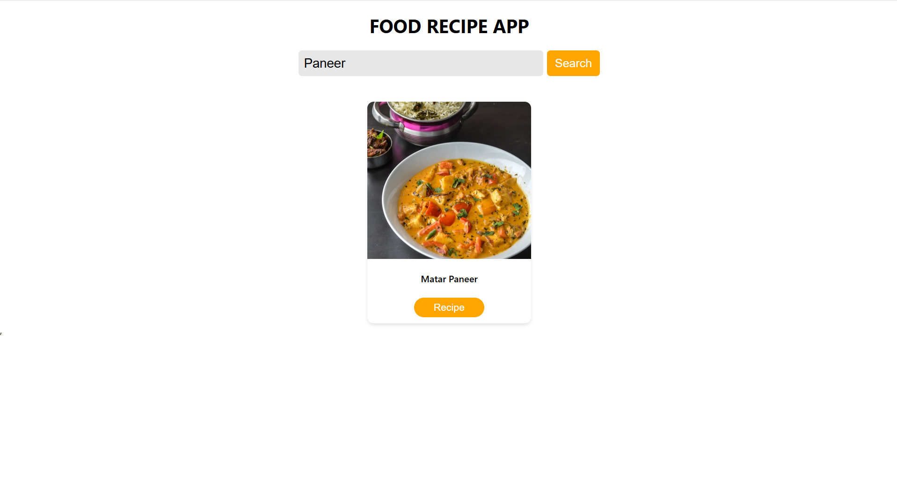
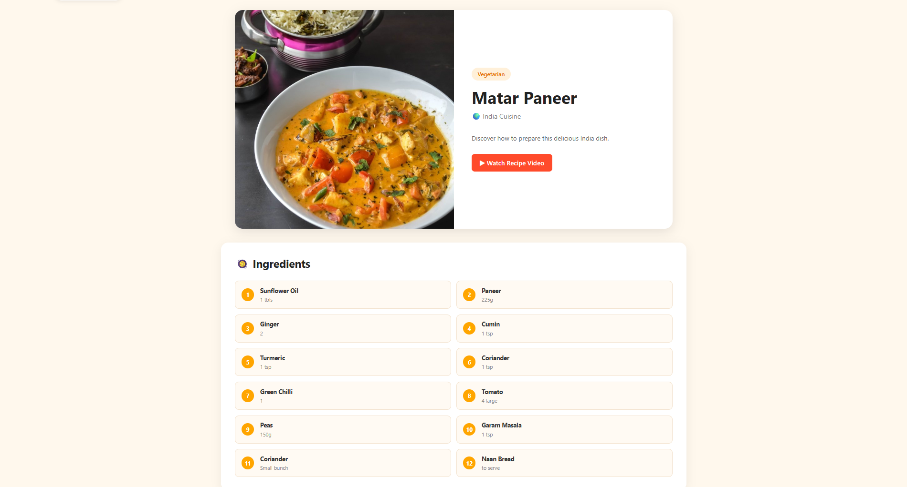
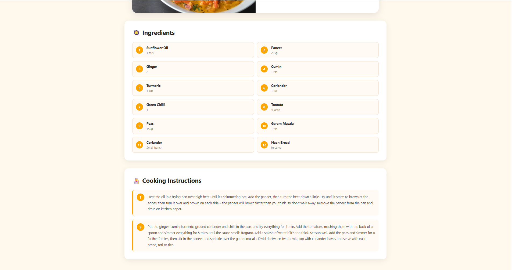

# 🍽️ Recipe Finder App

> A React.js application for discovering recipes, exploring ingredients, and viewing cooking instructions.

Recipe Finder is a responsive web application that allows users to search for recipes using **TheMealDB API**. Users can explore dishes, search by name or category, and view detailed recipe information with ingredients and cooking instructions.

## ✨ Features

### 🏠 Recipe Discovery & Search

* Search for recipes by name.
* Explore recipes by category.
* Fetch and display recipe data dynamically using TheMealDB API.
* Browse recipe results through an intuitive interface.

<p align="center">
  
</p>

### 🍲 Recipe Details

* View detailed information about selected recipes.
* Explore ingredients and cooking instructions.
* Navigate between pages using React Router.
* Access recipe information through a user-friendly interface.

<p align="center">
  
</p>
<p align="center">
  
</p>

### 📱 Responsive User Interface

* Responsive layouts for different screen sizes.
* Clean and user-friendly design.
* Smooth navigation between pages using React Router.

---

## 🛠️ Tech Stack

| Category          | Technology   |
| ----------------- | ------------ |
| Frontend          | React.js     |
| Routing           | React Router |
| API               | TheMealDB    |
| Styling           | CSS          |
| Deployment        | Vercel       |
| Development Tools | VS Code      |
| Version Control   | Git & GitHub |

---

## 💡 Technical Highlights

* Integrated TheMealDB API to fetch and display recipe information dynamically.
* Implemented recipe search by name and category.
* Displayed recipe ingredients and cooking instructions.
* Used React Router for multi-page navigation.
* Developed a responsive user interface for different screen sizes.

---

## 🚀 Getting Started

### 1. Clone the Repository

```bash
git clone https://github.com/sidd-singh04/Recipe-Finder.git
cd Recipe-Finder
```

### 2. Install Dependencies

```bash
npm install
```

### 3. Start the Development Server

```bash
npm run dev
```

Open the local URL displayed in your terminal to access the application.

> **Note:** The commands above assume your project uses Vite. Adjust them if your project uses a different setup.

---

## 👨‍💻 Author

**Siddharth Singh**

GitHub: [@sidd-singh04](https://github.com/sidd-singh04)
